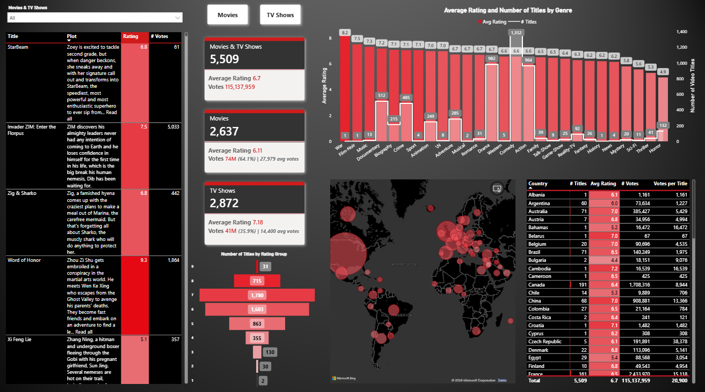
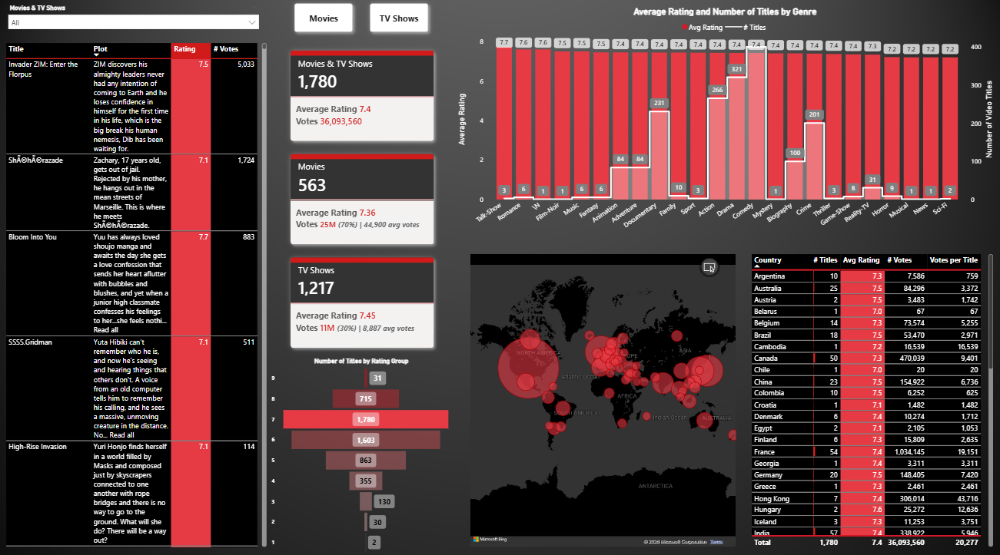
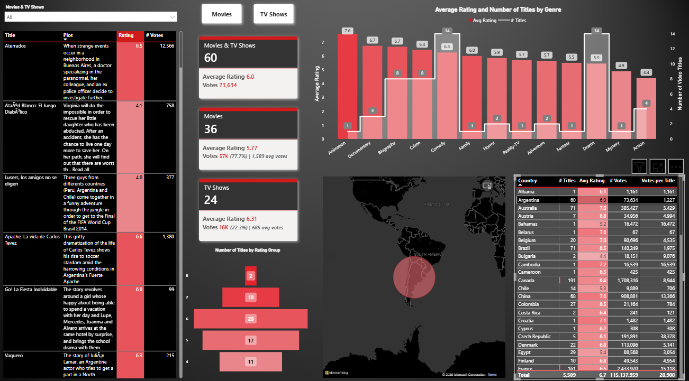

# Project Title
Streaming Service Dashboard

## Description
A dashboard containing insights of movies and series in one of popular streaming platform. The interactive dashboard was made using PowerBI features and DAX Queries to summarise different aspects with differnet types of visualisation. 

__Features__
- Table listing all movies and shows with their details and filter option
- Summary cards containing granular information for overall movies and series
- Funnel chart grouping the number of titles by their rating 1-10
- Stacked bar graph to show average rating and total titles for every genre 
- Map for geopgraphical concentration of number of titles and their average rating
- List of titles from different countries and their average ratings and total votes
- Higher ratings are marked with darker colours and gradually become lighter as the rating lowers

__Screenshots__

__Data Source__
Dataset - Netflix-Listings from Kaggle
